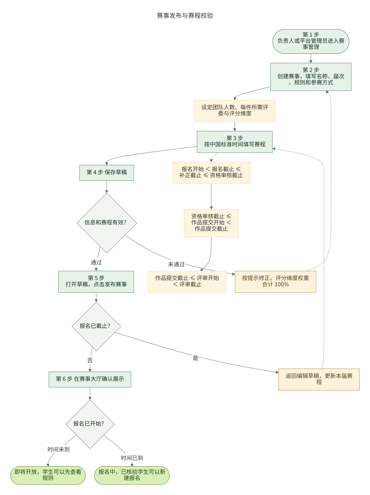
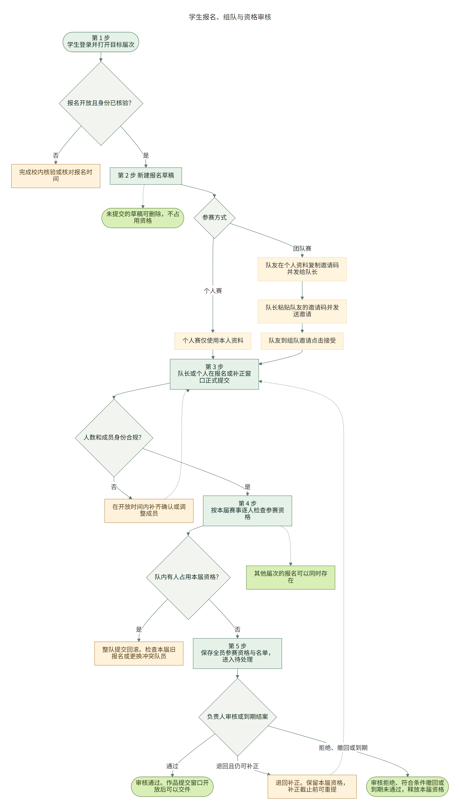

# 竞序 · 学生竞赛管理系统

竞序面向校内作品类竞赛，支持个人赛和团队赛。从赛事发布、组队报名、资格审核到 PDF 交件、匿名评审和获奖公示，各环节在同一个响应式 Web 应用中完成。

| 入口 | 主要功能 |
| --- | --- |
| 赛事大厅 | 浏览和筛选赛事，查看规则、赛程、获奖作品及公开的个人和团队名单 |
| 学生端 | 注册及身份核验、组队邀请、报名和补正、提交作品、查询结果 |
| 评委端 | 查看本人评审任务、预览匿名作品、提交评分、申请回避 |
| 赛事负责人 | 创建和发布赛事、审核报名、分派评委、预览和发布结果、保留公告更正历史 |
| 平台管理员 | 管理账号和角色、核验学生身份、查询中文操作审计 |

**技术栈**　Spring MVC · Spring JDBC · MyBatis · JSP/JSTL · 原生 JavaScript · MySQL

## 业务流程图

### 赛事发布与赛程校验

负责人填写赛程并保存草稿。发布时须早于报名截止。发布后，赛事大厅根据报名开始时间显示「即将开放」或「报名中」。



[赛事发布流程图源](docs/diagrams/competition-publishing.mmd)

### 学生报名、组队与资格审核

学生完成校内核验后可报名。团队赛正式提交时，系统检查已确认成员是否占用了本届赛事的参赛资格。学生可同时参与不同赛事。



[学生报名流程图源](docs/diagrams/registration-review.mmd)

## 本地启动

准备 **JDK 17、Maven 3.9、Tomcat 10.1、MySQL 8.0**。JDK 21 也可用于运行，Maven 编译目标为 Java 17。

1. **初始化数据库。** 从项目根目录打开 MySQL 客户端，使用有建库权限的账号执行 `SOURCE db/schema.sql;`。脚本会创建 `student_game_system` 库和初始角色。应用运行时使用只对该库有读写权限的 MySQL 账号。
2. **导入项目。** 在 IntelliJ IDEA 中打开 `pom.xml`，等待 Maven 导入。将项目 SDK 和 Maven 运行 JDK 设为 JDK 17。
3. **配置 Tomcat。** 在 **Run → Edit Configurations → Tomcat Server → Local** 选择本机 Tomcat 10.1。在 **Deployment** 添加项目的 `war exploded`，将应用上下文设为 `/student-game-system`。在 **Startup/Connection → Run** 中填写下表的环境变量。
4. **启动并登录。** 在 IDEA 点击 **Run**，打开 [本地首页](http://localhost:8080/student-game-system/)。首次连接空库时，系统会通过引导变量创建平台管理员。确认能登录后，可以移除这两个引导变量。

### 环境变量

| 变量 | 配置说明 |
| --- | --- |
| `STUDENT_DB_USERNAME` | MySQL 应用账号 |
| `STUDENT_DB_PASSWORD` | MySQL 应用账号的密码 |
| `STUDENT_DB_URL` | 可选。默认连接本机 3306 端口上的 `student_game_system`，数据库会话时区为 UTC |
| `STUDENT_ADMIN_USERNAME` | 首次启动时创建的平台管理员用户名 |
| `STUDENT_ADMIN_PASSWORD` | 平台管理员登录密码，至少 10 个字符且最多 72 个 UTF-8 字节 |
| `STUDENT_ATTACHMENTS_DIR` | 可选。Tomcat 可写的私有 PDF 目录，默认在实例目录下的 `data/jingxu` |

如需自定义连接地址，可参考 `jdbc:mysql://127.0.0.1:3306/student_game_system?connectionTimeZone=UTC&forceConnectionTimeZoneToSession=true`。环境变量在本地 Tomcat 运行配置中设置。

### 使用外置 Tomcat

IDEA 中没有 Tomcat 集成时，可以在项目根目录运行 `mvn compile war:exploded`，将生成的 `target/student-game-system/` 目录部署到 Tomcat 的 `webapps/` 下。设置同一组环境变量后，执行 Tomcat 的 `bin/catalina.bat run`（Windows）或 `bin/catalina.sh run`（Linux/macOS），再访问 [本地首页](http://localhost:8080/student-game-system/)。

已有旧版数据库时，按编号执行 [数据库迁移](db/migrations/) 中尚未应用的脚本。新库直接使用 [安装脚本](db/schema.sql)。

## 本地体验

空库可以从管理员发布赛事、学生注册和核验开始走流程。学生注册时必填申报学号。管理员通过「账户与核验」创建评委、赛事负责人或其他管理员账号，工作人员角色允许兼任。

要直接查看各阶段赛事、报名和获奖名单，可在单独的本地演示库依次导入 [基础演示数据](db/demo-data.sql)、[获奖名单示例](db/demo-awards.sql) 和 [分阶段演示数据](db/demo-scenarios.sql)。这些脚本使用 `student_game_system` 库名并写入合成数据，仅供本地演示。

| 示例账号 | 角色 |
| --- | --- |
| `demo.admin` | 平台管理员 |
| `demo.organizer` | 赛事负责人 |
| `judge01` 至 `judge06` | 评委 |
| `student01` 至 `student20` | 学生。含待核验和核验未通过示例 |
| `student21`、`student22` | 已停用和已删除账号 |

以上示例账号共用演示密码 `Jingxu-Demo2026!`。可将 [示例 PDF](db/demo-work.pdf) 用作新交件。要预览种子数据中的已有作品，查询 `submission_version` 表里的演示记录（`request_id` 以 `DEMO-WORK-` 开头），按对应的 `storage_key` 命名并复制示例 PDF 到私有附件目录。

## 工程结构

```text
db/                     建库、迁移和本地演示数据
docs/diagrams/          业务流程图与 Mermaid 图源
src/main/java/          控制器、业务服务、数据访问与权限检查
src/main/resources/     Spring、MyBatis 和通用连接参数
src/main/webapp/        JSP 页面与静态资源
```
